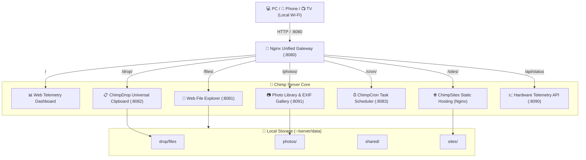

<div align="center">

```text
                                ▒▓████▓▒
                             ▓████████████▒
                          ▒██████████████████▒
                         █████████████████████▓
                       ▒████████████████████████
                      ▒██████████████████████████
                    ▒▒░▓████▒░░░░░▒▓▓▒░░░░░░▓███▓░▒▒
                   ▓█▓▓▓██▓░░██▓▓▓▒░░▒▓█▓▓█▒░▓██▓▒▓█▒
                  ▓▓▒▓████▓░▒▓█▓▓███▓███▓▓▓▓░░████▓▒▒▓
                  ▒▓░██████░░░▒▒░░▓▓▒▒░░▒▒░░░▓████▓░▒▒
                   ▒▓░░▓████▒░░▒▒░░░░░░▒▒░░▒▓███▓▒▒█
                     ▒▓███████▓░░▒█▒░▓▓░▒▓▓██████▓▒
                       ▓██████░░░░░▒░░░░░░██████▒
                       ▒█████▒░░░░░░░░░░░░░█████▒
                        ▓████░▒▒▒▒▒▒▒▒▒▒▒▒░▓███▓
                         ▒███▓░░▒▓▓▓▓▓▓▒░░▓███▒
                           ▒███▓░░░░░░░▓▓███▓
                             ▒████████████▓
                               ▒▒▓████▓▒▒
```

# 🐒 Chimp Home Server

**Turn any old Android smartphone or Linux SBC into a sleek, silent, low-power home server.**

[](LICENSE)
[](#)
[](#)
[](#)
[](#)

[Features](#-features) • [Architecture](#-architecture) • [Quickstart](#-quickstart-installation) • [Services](#-services-catalog) • [CLI Commands](#-cli-management) • [License](#-license)

</div>

---

## 💡 Why Chimp Home Server?

Old smartphones are incredible pieces of hardware often left sitting in drawers. They have:
* **Built-in UPS**: If the power goes out, the battery keeps your server running without interruption.
* **Ultra-Low Power**: Idles at ~1.5W, costing pennies per year in electricity compared to a bulky desktop or NAS.
* **Rich Sensors**: Wi-Fi, battery thermal sensors, cameras, and flash storage built right in.

**Chimp Home Server** transforms your phone into an authentic, production-grade Linux home server with a single installer command—**no root required**.

---

## ✨ Features

### 🔀 Unified Nginx Gateway
Access all web apps, tools, and endpoints through a single clean port (`:8080`) with subpath routing. No need to memorize messy port numbers.

### 📊 Real-Time Hardware Dashboard
* Live CPU multi-core load averages.
* Dynamic RAM gauge with free/used tracking.
* Storage disk usage analyzer.
* Real-time uptime counter and connection heartbeat.

### 📋 ChimpDrop (Universal Web Clipboard)
* **Instant Text & Code Syncing**: Seamlessly share snippets, URLs, notes, and code between your PC and phone.
* **Direct Image Paste (`Ctrl+V`)**: Press `Ctrl+V` with any screenshot in your clipboard to upload it directly with instant image preview.
* **Drag-and-Drop File Sharing**: Send PDFs, APKs, videos, or documents across your local network in seconds.
* **QR Code Sharing**: Click the **QR** button on any clip to generate an instant QR code on your PC screen—scan with your phone camera to open it immediately on mobile.
* **Real-Time Polling**: Live multi-device syncing every 3 seconds without refreshing.

### 📁 ChimpDrive (Cloud Storage & Explorer)
* Responsive file explorer with folder tree navigation and search.
* Built-in code/text editor with in-browser saving.
* Direct streaming for audio (`.mp3`, `.flac`) and video (`.mp4`, `.mkv`).
* One-click folder downloading as `.zip`.

### 📷 ChimpPix (Media Gallery & EXIF Inspector)
* Responsive media gallery with thumbnail caching.
* Full EXIF inspector (camera model, original capture date, resolution).
* Automated photo library syncing.

### ⏰ ChimpCron (Visual Task Scheduler & Automation)
* **Web-Based Schedule Manager**: Run automated shell scripts, backups, or disk cleanup routines without cryptic crontab syntax.
* **Flexible Triggering**: Repeat intervals (e.g. every 15 mins, every 4 hours), daily at specific times (e.g. `03:00`), or standard 5-field cron syntax (`*/10 * * * *`).
* **Instant Manual Execution**: Run any scheduled script on demand with live status indicators and real-time execution duration.
* **Execution Logs & Drawer**: Full capture of stdout, stderr, and exit codes for every run with one-click output inspection.

### 🌐 ChimpSites (Zero-Config Static Web Hosting)
* **Instant Local Web Hosting**: Host SPAs (React, Vue, Vite, Astro), HTML prototypes, or documentation sites directly from your phone.
* **Zero Configuration**: Any folder dropped into `~/server/data/sites/` is instantly served at `http://<IP>:8080/sites/<folder>/`.
* **Zero Python Overhead**: Served at native C-speed directly through Nginx with automatic MIME type mapping.
* **Interactive Launchpad**: Built-in visual hub at `/sites/` listing all hosted sites with launch buttons and upload zones.

### 🎨 Signature Chimp Terminal Experience
* Fully aligned custom ASCII Art banner upon terminal login.
* Dynamic column calculation preventing ugly line-wrapping across any terminal width.
* Quick status aliases (`server-status`, `server-restart`, `server-logs`).

---

## 🏗️ Architecture



---

## 🚀 Quickstart Installation

### Prerequisites
* Any Android phone with **[Termux](https://f-droid.org/packages/com.termux/)** (download from F-Droid, **not** Google Play)  
  *— or any Linux machine / Raspberry Pi running Debian/Ubuntu.*
* ~100 MB free internal storage.

### 1-Line Installer

Open Termux on your phone and run:

```bash
pkg install -y git && git clone https://github.com/nazufernandes/chimp-home-server.git ~/server && cd ~/server && ./install.sh
```

The automated script will:
1. Install Python, pip, Nginx, and Git.
2. Install Python dependencies (`Flask`, `Pillow`, `Werkzeug`).
3. Set up the `~/server` directory and data storage paths.
4. Configure Nginx reverse proxy routing.
5. Install the custom ASCII login banner into `~/.bashrc`.
6. **Optional Remote Access**: Independently configure Public Web Access (Ngrok) and/or Secure Remote SSH (Tailscale).
7. Start all server services in the background.

---

## 🌐 Remote Access & Remote SSH Options

Chimp Home Server treats **Public Web Hosting** and **Admin Remote SSH** as separate, modular capabilities during installation:

```text
  [1/2] Enable Public Web Access via Ngrok (share sites/files with anyone)? (y/N)
  [2/2] Enable Secure Remote SSH via Tailscale (remote terminal for admin)? (y/N)
```

You can enable **both, either, or neither** depending on your needs:

| Capability | Powered By | URL / Connection | Who is it for? | Client Setup |
| :--- | :--- | :--- | :--- | :--- |
| **Local LAN (Default)** | Home Wi-Fi | `http://192.168.x.x:8080/` | Devices on your home network | None |
| **Public Web Hosting** | Ngrok | `https://your-domain.ngrok-free.dev/` | Visitors worldwide via standard browser | **Zero** (no apps/VPNs) |
| **Remote SSH & Admin** | Tailscale | `ssh -p 8022 u0_a223@100.x.y.z` | You (the server admin) | Tailscale app on your device |

### 💡 Public Web vs. Tailscale SSH: How They Complement Each Other

* **Public Web Access (Ngrok)** opens an authentic HTTPS URL to the public web. Anyone can browse your static websites (`/sites/`), download files, or view the dashboard without installing anything.
* **Remote SSH (Tailscale)** creates an encrypted WireGuard mesh between your personal devices. It allows *you* to SSH into your phone's terminal (`ssh -p 8022 u0_a223@100.x.y.z`) from coffee shops or while traveling to inspect logs, run updates, and manage your server securely.
* **Can you use both together?**  
  **Yes!** Many users run Ngrok for their public-facing websites while using Tailscale as a private backchannel for SSH admin access. Tailscale is never required for public web visitors.

---

## 🌐 Services Catalog

| Service | Clean Gateway URL | Direct Port | Description |
| :--- | :--- | :--- | :--- |
| **Dashboard** | `http://<IP>:8080/` | `:8080` | Live telemetry & server launcher |
| **ChimpDrop** | `http://<IP>:8080/drop/` | `:8082` | Universal clipboard & drag-drop files |
| **ChimpDrive**| `http://<IP>:8080/files/`| `:8081` | Cloud file explorer & code editor |
| **ChimpPix**  | `http://<IP>:8080/photos/`| `:8091` | Media gallery with EXIF viewer |
| **ChimpCron** | `http://<IP>:8080/cron/`  | `:8083` | Visual task scheduler & background automation |
| **ChimpSites**| `http://<IP>:8080/sites/` | `:8080` | Zero-config static web hosting & launchpad |
| **Telemetry API**| `http://<IP>:8080/api/status`| `:8090` | JSON hardware status endpoint |

*(Replace `<IP>` with your server's local IP address, e.g. `192.168.1.13`)*

---

## 🛠️ CLI Management

Once installed, use these built-in aliases from any terminal session:

```bash
# Check status of all services
server-status

# Restart the entire server stack
server-restart

# Start / Stop all services
server-start
server-stop

# Tail live server logs
server-logs
```

---

## 🔒 Security & Battery Care Best Practices

1. **Keep Screen Off & CPU Awake**:
   Chimp automatically invokes `termux-wake-lock` on startup so Android's Doze mode does not sleep the CPU when the screen turns off.
2. **Battery Protection**:
   To prevent lithium battery swelling on an always-plugged-in phone:
   * Keep the phone in a cool, ventilated area.
   * If possible, use a smart plug or hardware timer to maintain the battery charge between 30% and 80%.
3. **Local Network Privacy**:
   By default, all endpoints bind to your local Wi-Fi network. Do not port-forward port 8080 directly on your router without adding authentication. For secure access outside your house, use **Tailscale** or **Cloudflare Tunnel**.

---

## 🤝 Contributing

Contributions are welcome!
1. Fork the Project
2. Create your Feature Branch (`git checkout -b feature/AmazingFeature`)
3. Commit your Changes (`git commit -m 'Add some AmazingFeature'`)
4. Push to the Branch (`git push origin feature/AmazingFeature`)
5. Open a Pull Request

---

## 📜 License

Distributed under the **MIT License**. See [`LICENSE`](LICENSE) for more information.

<div align="center">
  <sub>Built with ❤️ by Nazu Fernandes &amp; the open-source community.</sub>
</div>
